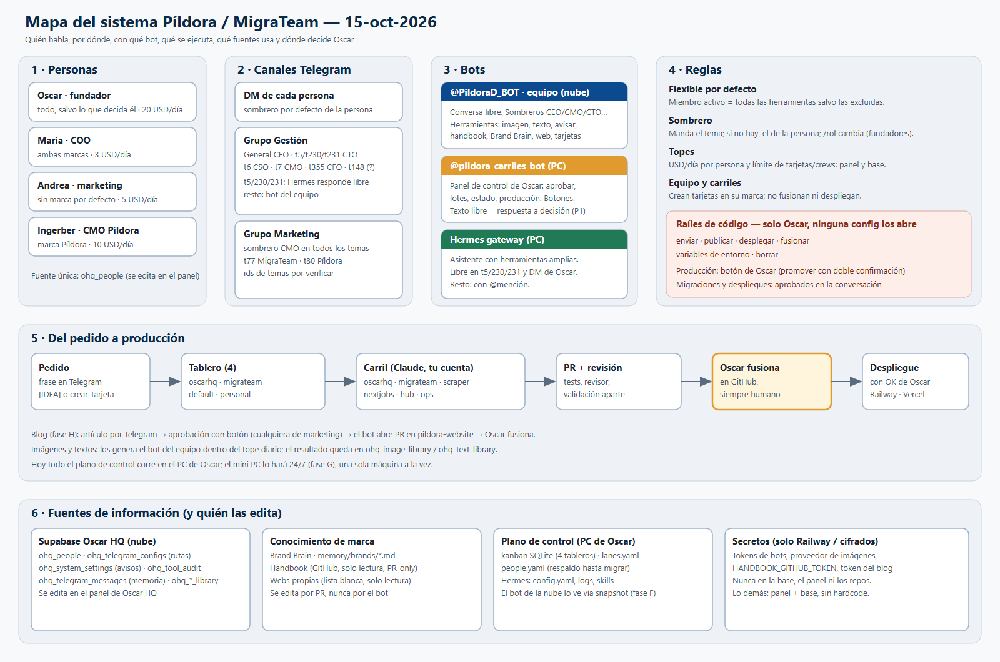

# Mapa de reglas del sistema (personas, canales, bots, carriles, tableros y fuentes)

**Fecha:** 2026-10-15 · **Autor:** Claude (sesión interactiva con Oscar) · **Estado:** vigente tras las decisiones de Oscar del 15-10
**Complementa:** `2026-10-15-arquitectura-bots-equipo.md` (fases y arquitectura), `2026-10-15` auditoría de aprobaciones (`docs/auditoria-aprobaciones-telegram-2026-10-15.md`), `2026-09-27-telegram-grupos-temas.md`, `2026-09-27-w3b-mecanismo-temas.md`.
**Imagen:** `decisions/img/2026-10-15-mapa-sistema.png` (fuente editable: `.svg` del mismo nombre).

Cada afirmación va marcada: **[HOY]** = verificado en código o base el 15-10; **[OBJETIVO]** = decidido, aún no construido (con su tarjeta); **[SIN VERIFICAR]** = dato que no se pudo comprobar.

---

## 1. Principios (decididos por Oscar)

1. **Flexible, sin limitar por ahora.** Permisos y roles no estorban: un miembro activo tiene todas las herramientas salvo las que se excluyan. [HOY, fase P+D]
2. **La configuración vive en el panel de Oscar HQ + base de datos**, incluida la de Telegram. Variables de Railway y SQL manual solo para **secretos** (tokens). Nada hardcodeado. [HOY para personas, rutas, avisos y topes; el resto, por fases]
3. **Raíles de código que ninguna configuración abre** (solo Oscar): `enviar`, `publicar`, `desplegar`, `fusionar`, `variables_entorno`, `borrar`. [HOY, `telegram_tools.HARD_RAILS`]
4. **Producción siempre humana:** fusionar PRs, desplegar, promover y migrar son de Oscar (o aprobadas por él en la conversación). El bot propone, no publica.
5. **El plano de control corre en UNA sola máquina a la vez.** Hoy, el PC de Oscar; a medio plazo, el mini PC como servidor 24/7 (fase G). Todo corre con la **cuenta de Claude de Oscar** (no API key): por eso hay topes.
6. **El control de calidad no se salta:** cada PR de carril pasa revisión y validación aparte antes de llegar a Oscar.

## 2. Personas

Fuente única **[OBJETIVO ya en marcha]**: tabla `ohq_people` (Supabase Oscar HQ), editable en el panel (Ajustes → Integraciones → Telegram). `tools/telegram/people.yaml` del hub queda como respaldo hasta migrarlo (fase F).

| Persona | telegram_id | Rol | Marca por defecto | Tope diario |
|---|---|---|---|---|
| Oscar | 6744452215 | fundador | MigraTeam (ver nota) | 20 USD |
| María | 5516823836 | COO | ninguna (ambas) | 3 USD |
| Andrea | 8313932936 | marketing | ninguna (el bot pregunta si no es obvia por el tema) | 5 USD |
| Ingerber | 8847860660 | CMO | Píldora (`pildora_digital_inbound`) | 10 USD |

- Decisiones del 15-10: María = **COO** (se corrigió `ohq_people`, que decía «gestión»); Andrea = **sin marca por defecto**.
- Nota: la marca por defecto de Oscar (MigraTeam) viene de la semilla de P+D; no se ha vuelto a confirmar.
- **Discrepancia por cerrar:** `people.yaml` del hub sigue diciendo Andrea → Píldora. Se elimina al migrar el hub a `ohq_people` (fase F).

## 3. Canales de Telegram

### 3.1 DMs
- Cada persona tiene su DM con el **bot del equipo** (@PildoraD_BOT). El sombrero por defecto sale hoy de `role_routes` [HOY] y debería salir de la persona [OBJETIVO, tarjeta de roles pendiente de crear].
- Hoy: Oscar → CEO; María → COO; Andrea e Ingerber → CMO. El DM de Oscar con el CMO no tiene mensajes previos a hoy.
- El **bot de carriles** (@pildora_carriles_bot) acepta DMs de Oscar y de las tres personas del equipo; un DM de no-owner solo crea una tarjeta `[IDEA]` asignada a Oscar [HOY]. **Decidido [OBJETIVO]:** el equipo crea tarjetas directas en el tablero de su marca (sin pasar por `[IDEA]`); producción sigue siendo solo de Oscar.

### 3.2 Grupo Gestión (`-1003530490339`)
Sombreros por tema según `role_routes` **[HOY, nombres de temas SIN VERIFICAR]**:

| Tema | Sombrero | Quién contesta libre |
|---|---|---|
| General (1) | CEO | bot del equipo |
| 5 | CTO | Hermes (libre) |
| 6 | CSO | bot del equipo |
| 7 | CMO | bot del equipo |
| 230 | CTO · MigraTeam | Hermes (libre) |
| 231 | CTO · Píldora | Hermes (libre) |
| 355 | CFO | bot del equipo |
| 148 | no definido en `role_routes` | — (**por verificar**) |

Avisos de leads nuevos: van a este grupo desde `ohq_system_settings.telegram_lead_alert_chat_ids` (ya no hay `ALERT_CHAT_ID` hardcodeado).

### 3.3 Grupo Marketing (`-1004277259008`)
- Sombrero **CMO** en todos los temas. En `role_routes`: temas 74 (CMO), 77 (CMO · MigraTeam), 80 (CMO · Píldora), 83 (CMO). [HOY]
- **Discrepancia:** el directorio de canales de Hermes lista los temas 1, 5, 6 y 7. Los ids de `role_routes` y los del directorio **no coinciden** [SIN VERIFICAR cuál es el real]. Comprobarlo con `getForumTopic`/la lista de temas antes de editar rutas.

### 3.4 Regla de resolución del sombrero
- **[HOY]** Solo por `role_routes`: tema → rol del tema; si no, `default_role` del chat; si no, CEO.
- **[OBJETIVO]** Tres capas con una fuente cada una: **persona** (`ohq_people`: permisos, tope, marca y sombrero por defecto), **tema** (tabla de temas en la base, editable en el panel) y **marca** (Brand Brain). Orden: manda el tema; si no hay, el sombrero por defecto de la persona; `/rol <sombrero>` lo cambia al momento (solo fundadores). `role_routes` queda como respaldo hasta migrarlo.

## 4. Bots

| Bot | Dónde corre | Para qué | Cómo se habla | Estado de reglas |
|---|---|---|---|---|
| **@PildoraD_BOT** (equipo; nombre «Oscar HQ Avisos») | Railway (nube) | Asistente conversacional del equipo con herramientas | Texto libre y fotos | [HOY] Herramientas abiertas para miembros activos; memoria en base; troceo de respuestas largas |
| **@pildora_carriles_bot** (Trabajos) | PC de Oscar (hub) | Panel de control de Oscar: aprobar, lotes, estado, producción | Comandos y botones. [OBJETIVO P1] texto libre cuenta como respuesta a la única decisión pendiente del tema | [HOY] solo comandos/botones; ignora texto libre salvo reply a un `force_reply` |
| **Hermes gateway** | PC de Oscar | Asistente con herramientas amplias; intake de peticiones | Libre en t5/230/231 y DM de Oscar; resto con @mención o reply | [HOY] `require_mention: true`; usa un único token de bot (usuario **SIN VERIFICAR**) |

Reglas comunes **[HOY]**:
- Herramientas del bot del equipo: `generar_imagen`, `redactar_texto`, `avisar_a_oscar`, `leer_handbook`, `consultar_brand_brain`, `ver_web`, `estado_tarjeta`, cola de outreach. Fase C añade `ejecutar_crew` y `crear_tarjeta` **sin botón de confirmación** (decisión de Oscar 15-10; el aviso a Oscar es opcional) y con topes. [OBJETIVO]
- Topes: USD por persona y día (`ohq_people.tope_diario_usd`), auditoría en `ohq_tool_audit` (no guarda el texto del usuario).
- Un mensaje, un bot: la regla del 27-09 evita respuestas dobles pero deja temas sin interlocutor (ver auditoría §2).
- Config de bots (rutas, personas, avisos, topes) → panel. Tokens → Railway / `ohq_telegram_configs` cifrados.

## 5. Carriles, tableros y flujo de trabajo

### 5.1 Carriles (`tools/agent-lanes/lanes.yaml`)
| Carril | Repo | Tablero |
|---|---|---|
| `claude-oscarhq` | `oscar-hq` | `oscarhq` |
| `claude-migrateam` | `migrateam` | `migrateam` |
| `claude-scraper` | `Scraper` | `oscarhq` |
| `claude-nextjobs` | `nextjobs/autoapply_v5` | `default` |
| `claude-hub` | `oscar-command-hub` | `default` |
| `claude-ops` | sin repo | `oscarhq` |

Más el revisor y el integrador. **[SIN CARRIL]** `pildora-website`: los cambios de la web de Píldora aún no tienen carril (el PR del cargador de blog se hizo con un subagente puntual).
Máximo **3 flujos de código activos** a la vez; una rama nunca se comparte entre conversaciones.

### 5.2 Tableros (kanban SQLite en el PC de Oscar)
| Tablero | Para qué | Notas |
|---|---|---|
| `default` | Hub, orquestación, NextJobs, tarjetas generales | Tarjetas creadas desde Telegram caen aquí si no hay marca |
| `oscarhq` | Oscar HQ / Píldora (bot, crews, Signal, CRM, legal/finanzas de Píldora) | Tablero de la marca Píldora |
| `migrateam` | MigraTeam | Tablero de la marca MigraTeam |
| `personal` | Personal / admin | Fuera de los carriles de código |

Regla actual de `people.yaml`: la primera marca de la persona decide el tablero de sus tarjetas (Píldora → `oscarhq`, MigraTeam → `migrateam`). Con «sin marca por defecto» (Andrea, María) el bot debe **preguntar la marca** al crear la tarjeta [OBJETIVO, fase C].

### 5.3 Del pedido a producción
1. Pedido en Telegram → tarjeta (`[IDEA]` hoy; `crear_tarjeta` directa, objetivo).
2. Tablero de la marca → carril correspondiente (Claude con la cuenta de Oscar, rama `lane/<id>`).
3. PR + revisión + validación aparte (tests, seguridad).
4. **Oscar fusiona** en GitHub. Sin excepciones.
5. **Despliegue con OK de Oscar** (Railway `railway up` en Oscar HQ; Vercel/Railway por Git en los demás). Migraciones: aprobadas por Oscar y aplicadas por la sesión interactiva.
6. Reinicio del hub (`lanes.py restart --drain`) cuando cambia el código del runner.

### 5.4 Flujos especiales
- **Blog (fase H) [OBJETIVO, retenida]:** artículo por Telegram (.md/.txt/.docx) → `proponer_articulo` → aprobación por botón de **cualquiera del equipo de marketing** (se guarda quién y cuándo) → el bot abre un **PR** en `pildora-website` (rama `blog/<slug>`, nunca push a `main`) → Oscar fusiona. Requiere PR del cargador `.md` fusionado y el token de GitHub de escritura (secreto de Railway). MigraTeam (BLOG-02) va después con el mismo patrón.
- **Imágenes [HOY, con fallo conocido]:** `generar_imagen` funciona (proveedor OpenRouter/Gemini; coste ~0,011 USD) pero interpretó «nano banana» como contenido, no cargó el contexto de marca e inventó un dominio. Tarjeta `t_d9360c8b` (prioritaria, retenida por el máximo de flujos).
- **Auditoría de aprobaciones:** P1 (texto libre = respuesta, `t_83278452`), P3 (avisos sin recortes, `t_e71e7aca`) en marcha; P2 (relé determinista, `t_c09d8034`) y P4 (no perder respuestas + bug de `clarify`, `t_56c47cf9`) retenidas.

## 6. Fuentes de información y fuentes de verdad

| Dato | Dónde vive (verdad) | Quién lo edita | Copias / duplicados a eliminar |
|---|---|---|---|
| Personas, roles, marca, tope | `ohq_people` (Supabase Oscar HQ) | Panel de Oscar HQ | `people.yaml` del hub; `role_routes.people` |
| Sombrero por chat/tema | `ohq_telegram_configs.role_routes` **[HOY]** → tabla de temas **[OBJETIVO]** | Panel | JSON anidado a mano |
| Avisos (leads, `avisar_a_oscar`) | `ohq_system_settings` | Panel | Constante `ALERT_CHAT_ID` (**eliminada** en P+D) |
| Conversaciones del equipo (memoria) | `ohq_telegram_messages` | El bot | Memoria en proceso (eliminada con el troceo/memoria en base) |
| Auditoría de herramientas y gasto | `ohq_tool_audit` | El bot | — |
| Imágenes / textos generados | `ohq_image_library`, `ohq_text_library` | El bot | — |
| Conocimiento de marca | Brand Brain y `memory/brands/*.md` (canónico de ejecución); Handbook (`pildora-handbook`, PR-only) como SSOT humano | Oscar/equipo por PR | Sync handbook→memory manual |
| Estado de tarjetas | Kanban SQLite (PC de Oscar), 4 tableros | Carriles, Hermes, bot de Trabajos | Copia en `push_kanban_snapshot.py` para el bot del equipo; **[OBJETIVO fase F]** `ohq_ops_state` en la nube |
| Código de carriles y reglas del hub | `tools/agent-lanes/` (`lanes.yaml`, `people.yaml`) | PR | Rutas `C:/Users/oscar/...` por parametrizar (fase G) |
| Config de Hermes | `%LOCALAPPDATA%\hermes\config.yaml` y skills | Oscar | **Contiene secretos en claro (hash de contraseña, secret del dashboard, API key de ClickUp): rotar** |
| Secretos (tokens de bots, proveedor de imágenes, `HANDBOOK_GITHUB_TOKEN`, token del blog) | Railway / cifrados | Solo Oscar | Nunca en base, panel ni repos |

## 7. Brechas conocidas y tarjetas

| Brecha | Tarjeta / estado |
|---|---|
| El sombrero no sale de la persona (dos listas de roles) | Tarjeta de roles por crear (propuesta aprobada en conversación, pendiente de abrir) |
| Fase C: `ejecutar_crew` y `crear_tarjeta` sin botón, con topes | `t_69474e51` en marcha |
| Imágenes: contexto de marca, sin dominios inventados | `t_d9360c8b` prioritaria, retenida |
| Auditoría P1–P4 | `t_83278452`, `t_e71e7aca` en marcha; `t_c09d8034`, `t_56c47cf9` retenidas |
| Tarjetas `ready` asignadas a Oscar creadas desde Telegram no le avisan (caso `t_8e370853`, 9,5 h sin aviso) | Anotado en P1 `t_83278452` |
| Estado operativo en la nube (F) · Mini PC (G) · Topología de bots (E) · Blog (H, BLOG-02) | `t_b5e31b70`, `t_bf5cf039`, sin tarjeta E, `t_0a4d7616`, `t_01691915` |
| Seguimientos menores de P+D: no borrar al último fundador, auditar `/permisos`, validar `people` heredado | Sin tarjeta |
| Ids de temas de Marketing no coinciden entre `role_routes` y Hermes; tema 148 de Gestión sin rol | Por verificar |
| `pildora-website` sin carril, sin CI ni protección de rama (push directo a `main` = producción) | Decisión de Oscar pendiente |
| Smart App Control / WinError 4551 (causa del 29-09 no concluyente) | Vigilante en marcha; sin causa |

## 8. Cómo volver a revisar y rehacer estas reglas

Cuando algo cambie (persona nueva, marca nueva, tema nuevo, carril nuevo), el orden es este y **no hay que tocar código** para los pasos 1 a 4:
1. **Persona nueva:** panel → Ajustes → Integraciones → Telegram → Personas: id, nombre, rol, marca por defecto, tope. Añadir el id a los chats permitidos del bot si hace falta.
2. **Tema o grupo nuevo:** panel → rutas: sombrero, marca, audiencia (`private`/`shared`), alcance de datos. Si lo atiende Hermes, añadirlo a `free_response_topics` de Hermes (config local).
3. **Herramienta que se quiere cerrar a alguien o a un tema:** panel → `excluded_tools` de esa ruta o persona. Los raíles de código no se tocan desde ahí.
4. **Avisos:** panel → destinatarios de leads y de `avisar_a_oscar`.
5. **Carril o tablero nuevo:** PR en `tools/agent-lanes/lanes.yaml` (repo, tablero, modelo, presupuesto).
6. **Cambiar un principio o un raíl de código:** PR + decisión escrita en `decisions/` (este documento se actualiza en el mismo PR).

Para una **revisión completa** de reglas: recorrer las secciones 2→6 de este documento comparando con la base (`ohq_people`, `ohq_telegram_configs`, `ohq_system_settings`), el panel y `lanes.yaml`, y marcar cada discrepancia como en la tabla de §7.

## 9. Decisiones de Oscar que fundamentan este documento (15-10)
Configuración en panel + base (no variables de Railway ni SQL manual) · permisos y roles flexibles · mini PC como servidor 24/7 a medio plazo, todo en el PC hasta entonces · fusiones siempre de Oscar · blog: el bot abre PR y Oscar fusiona, aprueba cualquiera de marketing · María = COO · Andrea = sin marca por defecto · fuente única de personas = `ohq_people` · el equipo crea tarjetas directas en su marca · fase C sin botón de confirmación, aviso a Oscar opcional · sombrero de la persona/tema desde la base (propuesta pendiente de abrir como tarjeta).
