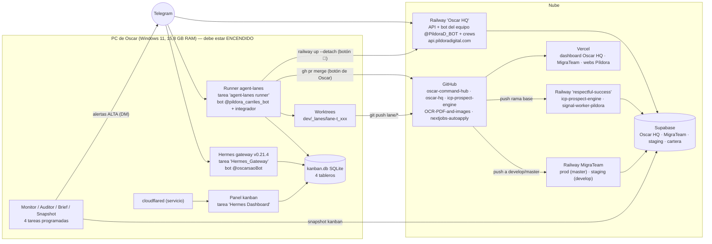
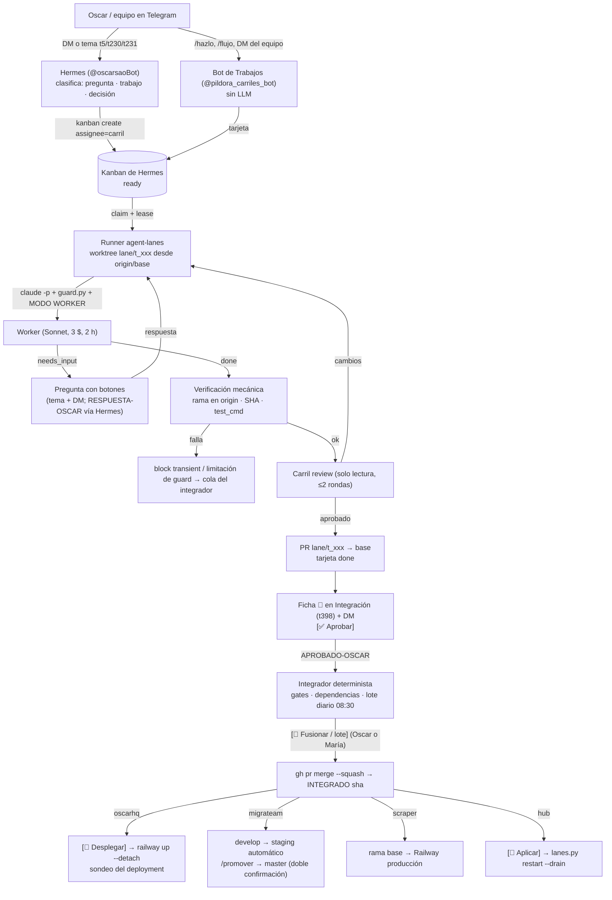

# 01 · Mapa del sistema

Fecha de referencia: 21-10-2026. Todo lo que sigue se ha comprobado contra disco, git, `lanes.yaml` y la CLI de Railway
el 21-10 salvo donde se marca **[sin verificar]**.

## 1. Repos

| Repo (GitHub) | Ruta local | Rama de trabajo | Qué es | Despliegue |
|---|---|---|---|---|
| `oscarsao/oscar-command-hub` | `C:/Users/oscar/oscar-command-hub` | `main` (HEAD `b4ea602` el 21-10) | Cerebro compartido: decisiones, contexto y **el único código del hub**: `tools/agent-lanes` (runner de carriles + bot de Trabajos + integrador), `tools/monitor`, `tools/telegram`, `tools/hermes-config`, `tools/infra` | Sin deploy. Fusionar en `main` no despliega: hay que **aplicar** (reinicio ordenado del runner, ver 03) |
| `oscarsao/oscar-hq` | `C:/Users/oscar/dev/oscar-hq` | `master` | Oscar HQ: API FastAPI + CrewAI (`src/`), dashboard Next.js (`dashboard/`), bot del equipo de Telegram, Signal/CRM | Backend: **manual** `railway up` (GitHub NO conectado a Railway, a propósito). Dashboard: Vercel |
| `oscarsao/icp-prospect-engine` (= "Scraper") | `C:/Users/oscar/dev/Scraper` | `cambio/multiverse-benchmark-harness` (no `main`; `Scraper/CLAUDE.md:28-29`) | Signal Engine / signal_core, ICPs Píldora y Multiverse, worker de la cola `ohq_signal_jobs` | Railway proyecto **respectful-success**, servicios `icp-prospect-engine` y `signal-worker-pildora` (ambos Online el 21-10 según `railway status`). `signal_worker/Dockerfile` con contexto = raíz del repo |
| `oscarsao/nextjobs-autoapply` | `C:/Users/oscar/nextjobs/autoapply_v5` | `master` | NextJobs AutoApply (pausado) | manual (`railway.toml` + `vercel.json` en el repo) |
| `PildoraDigital/OCR-PDF-and-images` (= MigraTeam) | `C:/Users/oscar/dev/migrateam` | **`develop` = staging**; `master` = producción solo por `release/<fecha>` (`migrateam/CLAUDE.md:503-504`) | SaaS para despachos de extranjería: backend FastAPI + Alembic, frontend Next.js | Push a `master` → Railway + Vercel producción; push a `develop` → Railway staging + Vercel develop. Start command de Railway ejecuta `alembic upgrade head` |

Rutas que la documentación cita pero **no existen en disco** el 21-10: `C:/tmp/vpdn-marketplace`, `C:/Users/oscar/fintrade-mvp`,
`C:/Users/oscar/migrateam-checker` (ver `README.md` § Discrepancias).

Worktrees: los carriles trabajan en `C:/Users/oscar/dev/_lanes/lane-<task_id>` (`lanes.yaml` → `defaults.worktree_root`);
el integrador en `C:/Users/oscar/dev/_lanes/_integrator`; el carril ops en `C:/Users/oscar/dev/_lanes/ops/<id>`;
las sesiones humanas del hub en `C:/Users/oscar/dev/_hub-wt/<nombre>` (13 vivos el 21-10, `git worktree list`).

## 2. Servicios y dónde corre cada cosa

| Componente | Dónde corre | Cómo se arranca / verifica | Fuente |
|---|---|---|---|
| **Runner de carriles** (`tools/agent-lanes/runner.py --all`): reclama tarjetas, lanza `claude -p`, verifica, pasa a `review`; incluye el **bot de Trabajos** (@pildora_carriles_bot), el **integrador** y los recordatorios | PC de Oscar, tarea programada de Windows **"agent-lanes runner"** (pyw, sin ventana; `install-service.ps1`) | `py -3.12 lanes.py status` (21-10: `runner: VIVO (pid 4304)`); log `tools/agent-lanes/.state/runner.log` | `tools/agent-lanes/README.md`, `lanes.yaml` |
| **Hermes** (hermes-agent v0.21.4, bot @oscarsaoBot) | PC de Oscar, tarea **"Hermes_Gateway"**; instalación en `%LOCALAPPDATA%/hermes` (config `config.yaml`, `.env`, `kanban.db`, `state.db`) | `hermes --version`; `gateway_state.json` (21-10: `running`, pid 2760) | `hermes --version` 21-10 |
| **Kanban de Hermes** (SQLite, 4 tableros: `default`, `oscarhq`, `migrateam`, `personal`) | `%LOCALAPPDATA%/hermes/kanban.db` + `kanban/boards/<board>/kanban.db` | CLI `hermes kanban --board <b> list --json` | `decisions/2026-10-15-arquitectura-bots-equipo.md` §9.1 |
| **Panel del kanban** `kanban.pildoradigital.com` | PC, tarea **"Hermes Dashboard"** publicada por túnel Cloudflare (servicio Windows `cloudflared`, Running el 21-10) | `tools/infra/instalar-panel-y-tunel.ps1` | idem |
| **Monitor** (`tools/monitor/monitor.py --headless`): PC, carriles, Hermes, salud HTTP, sonda de Supabase, alertas al DM | PC, tarea **"Monitor Oscar (alertas)"**; alertas en `tools/monitor/.state/alerts.log` | `py -3.12 tools/monitor/monitor.py --once` | `docs/monitor-db-supabase.md` |
| **Auditor diario** (`auditor.py`, determinista) | PC, tarea **"Auditor diario carriles"** L-V 07:40 (corrió el 21-10, resultado 0) | `py -3.12 auditor.py --dry-run` | `instalar_auditor.ps1` |
| **Resumen 08:00** (`brief/brief_diario.py`) | PC, tarea **"Resumen diario Hermes"** L-V 08:00 | `/hoy` en el bot de Trabajos | `brief/instalar-brief.ps1`, `bandeja.yaml` |
| **Snapshot del kanban a Supabase** (lo lee el bot del equipo) | PC, tarea **"Kanban snapshot Oscar HQ"** cada 15 min (`oscar-hq/scripts/push_kanban_snapshot.py`) | `schtasks`: 21-10 11:30 OK | arquitectura-bots §9.1 |
| **Oscar HQ API + bot del equipo (@PildoraD_BOT, "Oscar HQ Avisos") + crews** | **Railway**, proyecto "Oscar HQ", servicio "Oscar HQ", entorno production; URL `https://api.pildoradigital.com` (también `oscar-hq-production.up.railway.app`) | `railway status` desde `C:/Users/oscar/dev/oscar-hq` (CLI 5.59.0 enlazada) | `railway status` 21-10 |
| **Dashboard Oscar HQ** | Vercel (dominio `app.pildoradigital.com` según memoria; `DEPLOY.md` cita un alias viejo) **[sin verificar]** | — | `oscar-hq/DEPLOY.md` |
| **Supabase** | Nube. Oscar HQ = proyecto `kkkxptlwknyafbavajhj` (plan Micro, 60 conexiones); MigraTeam prod + staging; cartera | MCP de Supabase / panel | `docs/monitor-db-supabase.md` |
| **Signal workers** | Railway `respectful-success`: `signal-worker-pildora` (worker de `ohq_signal_jobs`, imagen `signal_worker/Dockerfile`) e `icp-prospect-engine` | `railway status` desde `C:/Users/oscar/dev/Scraper` | 21-10 |
| **MigraTeam backend/frontend** | Railway (prod y staging) + Vercel; `/health` expone `commit_sha` y `alembic_version` | `promote.migrateam` en `lanes.yaml` | `lanes.yaml:244-251` |

**Todo el plano de control depende de que el PC de Oscar esté encendido** (runner, Hermes, kanban, panel, monitor). Con el PC
apagado las tarjetas esperan en `ready` y el equipo no ve nada. Decisión 15-10: mover a medio plazo al mini PC Minisforum
(64 GB RAM, comprado 24-09) — todavía sin nada alojado verificado (`decisions/2026-10-15-arquitectura-bots-equipo.md` §6 fase G, §9.3).

### Diagrama de infraestructura

## 3. Flujo de una petición: Telegram → Hermes → kanban → carril → PR → revisión → integrador → despliegue

Contrato: `decisions/2026-09-27-arquitectura-carriles.md` §3-5. Lo que sigue es lo que hace el código hoy.

1. **Intake.** Oscar escribe en el DM de Hermes o en un tema de Gestión (t5/t230/t231, donde Hermes responde sin mención).
   Hermes crea la tarjeta en el kanban con `assignee` = carril (`claude-oscarhq`, `claude-migrateam`, `claude-scraper`,
   `claude-nextjobs`, `claude-hub`, `claude-ops`) u `oscar`. Alternativas sin LLM: `/hazlo <texto>` y `/flujo <texto>` del
   bot de Trabajos (`agent_lanes/commands.py:69-87`); el equipo (María/Ingerber/Andrea) por DM al bot de Trabajos crea
   `[IDEA de <nombre>]` asignada a `oscar` (`collab_intake.py`); el bot del equipo (@PildoraD_BOT) crea `[IDEA]` con
   `avisar_a_oscar` (`oscar-hq/docs/TELEGRAM_BOTS_QUIEN_ES_QUIEN.md`).
2. **Claim.** El runner (cada 60 s, `runner.interval_seconds`) lista las tarjetas `ready` del tablero del carril
   (`lanes.yaml` → `board:`), reclama con lease (`claim --ttl = max_runtime + 300 s`, porque el heartbeat de la CLI 0.21.4 no
   extiende el claim), comprueba el **candado de repo** (`git remote get-url origin` == `github:` del carril) y crea el
   worktree `C:/Users/oscar/dev/_lanes/lane-<id>` con la rama `lane/<id>` desde `origin/<base>` (`git_ops.py`).
3. **Worker.** `claude -p` con `--permission-mode acceptEdits`, `--strict-mcp-config` (sin MCP), rol
   `roles/implementador.md`, hooks `PreToolUse` → `contract/guard.py` (bloquea push a ramas que no sean `lane/*`, `--force`,
   `gh pr merge`, `railway`, `vercel`, `alembic` contra BD no local, `.github/workflows/`), presupuesto `max_budget_usd` (3 $),
   `max_runtime_seconds` (7200), modelo Sonnet. Variable `AGENT_LANES_TASK` → activa el **MODO WORKER** de `~/.claude/CLAUDE.md`
   (`worker.py:148-151, 203, 268`). Salida tipada por `contract/result.schema.json`: `done | needs_input | failed`.
4. **Verificación mecánica** (`verify.py`): rama en `origin`, SHA existe, `test_cmd` del carril ejecutado por el runner
   (`checks.py` = `git diff --check` + compilación; en MigraTeam además `scripts/check_claims.py --diff` de la base; en el hub
   la suite completa de agent-lanes). Si no cuadra → `block transient`, nunca `done`.
5. **Revisión** (carril `review`, `review.py`): un `claude -p` de solo lectura (`AGENT_LANES_ROLE=revisor`, solo
   `git diff|log|show|status`), hasta `max_review_rounds: 2`. Aprueba → la tarjeta pasa a `done` y se abre PR.
6. **Aprobación de Oscar** desde Telegram: ficha 🚦 en el tema **Integración y despliegues** (Gestión t398) con copia al DM,
   botón `[✅ Aprobar]` → comentario `APROBADO-OSCAR … PR <url>` (autor `oscar-telegram`).
7. **Integrador** (`integrator.py`, determinista, activo solo con `INTEGRATOR_ENABLED=true` en `agent-lanes/.env`): gates en
   worktree temporal (conflictos, `test_cmd`, secret-scan, un solo head de Alembic, migraciones manuales), respeta dependencias
   padre→hijo (`deps.py`). Con `batch: daily` (oscarhq y migrateam) junta lo aprobado en **un lote** `release/lote-<marca>-<fecha>`
   a las 08:30 o con `/lote <marca>` y un solo botón `[🔀 Fusionar lote]` (`docs/lote-diario-integrador.md`). `claude-hub`
   va PR a PR. Fusión: `gh pr merge --squash --match-head-commit <sha>` → `INTEGRADO <sha>`.
8. **Despliegue**, por política del carril (`lanes.yaml` → `integrator.lanes`):
   - `claude-oscarhq`: `deploy: railway_up` → botón `[🚀 Desplegar]` = `railway up --detach` desde un worktree limpio del commit
     fusionado + sondeo de **ese** deployment hasta SUCCESS (nunca `/api/health`). Migraciones `supabase/migrations/` son manuales
     (`manual_migrations`): sin `✅ Migración aplicada` no hay botón de deploy.
   - `claude-migrateam`: `deploy: on_merge`, `risk: staging` → fusionar en `develop` despliega **staging**; producción solo por
     `/promover migrateam` (PR `develop→master`, doble confirmación, `promote.py`).
   - `claude-scraper`: `deploy: on_merge`, `risk: production` → fusionar en la rama base **despliega a producción**; se verifica con
     GitHub Deployments.
   - `claude-hub`: `deploy: none`, `apply: restart_drain` → botón `[🔁 Aplicar]` = `lanes.py restart --drain` en el checkout vivo
     (fast-forward de `main` + reinicio del runner).
   - `claude-nextjobs`: sin entrada en `integrator.lanes` → no se integra desde Telegram.
9. **Reconciliación** (`reconcile.py`): PR cerrado sin fusionar, tarjetas obsoletas, próximo paso con responsable.

### Diagrama del flujo

## 4. Roles de las personas

| Quién | Rol | Qué puede hacer hoy (verificado) |
|---|---|---|
| **Oscar** | Dueño y decisor final | Todo. Único que puede aprobar producción según las decisiones escritas; `OWNER_TELEGRAM_ID` en `agent_lanes/decisions.py` |
| **María** | COO | **Operadora** del bot de Trabajos desde el 19/20-10 (`people.yaml` `operador: true`, commit `a41da56`): mismos comandos, botones y aprobaciones que Oscar, firmadas con su nombre. Autorizada también en Hermes (`tools/hermes-config/autorizar_maria.sh`, 28-09). Regla de proceso (no técnica): el código de MigraTeam requiere permiso de Oscar (memoria 12-10) |
| **Ingerber** | CMO Píldora | DM al bot de Trabajos → `[IDEA]`; bot del equipo en Marketing |
| **Andrea** | Marketing (a prueba) | Igual que Ingerber; sin marca por defecto desde el 15-10 (`ohq_people`) |
| **Integrador** | Rol (sesión de Claude Code o el integrador automático) | Compone, pasa gates, único propietario de Alembic; nunca despliega sin Oscar |

Fuentes de verdad: ejecución = kanban de Hermes; negocio = kanban de Píldora (app.pildoradigital.com); personal = ClickUp;
conocimiento = este repo (`CONTEXT.md` § Fuentes de verdad). Personas: `tools/telegram/people.yaml` (hub) y tabla `ohq_people`
(Supabase Oscar HQ, panel) — hoy duplicadas (`decisions/2026-10-15-mapa-reglas-sistema.md` §2).
